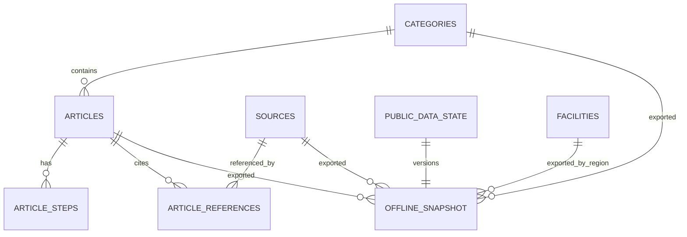

# Thiết kế cơ sở dữ liệu FirstAid — P0

Tài liệu triển khai cho nhóm, đối chiếu baseline 2.0 ngày 23/10/2026 và mã nguồn hiện có ngày 02/11/2026. [06_SHARED_CONTRACTS.md](baseline-v2/06_SHARED_CONTRACTS.md) vẫn là hợp đồng JSON/API; tài liệu này quy định cách lưu trữ, không tự thay đổi contract.

## 1. Quyết định thiết kế

| Thành phần | Cách lưu | Lý do |
| --- | --- | --- |
| Spring Boot | PostgreSQL 15+; 8 bảng nghiệp vụ | Admin CRUD, kiểm publish, public read, snapshot nhất quán |
| Flutter | SQLite; 7 bảng nội dung + `app_metadata` | Cài mới đọc ngoại tuyến, full snapshot thay trong một transaction |
| FastAPI RAG | `corpus.jsonl` và BM25 index có version | Corpus được tuyển chọn và build bằng script; không cần bảng/vector DB |
| Guided flow | JSON đi kèm app | Chỉ vài flow cố định, resolve bằng `category_code + variant_key` |

DDL tham chiếu: [PostgreSQL](database/001_postgresql_schema.sql) và [SQLite](database/002_sqlite_schema.sql). Backend đã có JDBC, PostgreSQL driver và Flyway; `backend/src/main/resources/db/migration/V1__schema.sql` triển khai DDL PostgreSQL này. Mobile hiện chưa có SQLite package/schema runtime; file SQLite vẫn là thiết kế để tích hợp sau. Không dùng `ddl-auto=update` để thay migration.

### Ranh giới dữ liệu hiện có

- Backend đã thay sườn `HandbookService`/`FacilityService`/`TriageService` bằng JDBC, Flyway, Admin auth và API theo contract. `backend/src/main/resources/db/migration` là migration đang được ứng dụng chạy; hai file SQL trong `docs/database` là bản tham chiếu thiết kế.
- `mobile/assets/content/reference_library.json` hiện là `schema_version: 2`, `kind: editorial_preview`, có 18 category, 24 article và 14 source. Migration seed category/source; [script import tùy chọn](../backend/scripts/import_reference_drafts.sql) chỉ đưa 24 article vào DB biên tập với trạng thái DRAFT, `content_checked=false`. **Không** import thành bài PUBLISHED hoặc gọi là `OfflineSnapshot` schema 1.
- Giữ UUID/source code/category code ổn định khi biên tập dữ liệu để backend, mobile và corpus dùng chung. Chỉ đưa bài vào public sau khi nhóm kiểm nội dung, quyền sử dụng và đối tượng áp dụng. Không tạo cơ sở y tế hoặc số liên hệ thật từ fixture.

## 2. Quan hệ dữ liệu

`OFFLINE_SNAPSHOT` trong sơ đồ là DTO được tạo khi đọc, **không phải bảng**. `admin_users` độc lập; mobile không có user. Chat request/response, khoảng cách và lịch sử hội thoại không có bảng.

## 3. Từ điển bảng PostgreSQL

PK nghiệp vụ là UUID do ứng dụng tạo; timestamp lưu `timestamptz` UTC và serialize ISO 8601 `Z`. `code`, `slug`, `variant_key` là khóa ổn định để liên kết; đổi tiêu đề không đổi khóa. JSON ra API dùng `snake_case`, nhưng JPA entity phải map thành DTO, không serialize entity trực tiếp.

| Bảng | Trường chính và kiểu | Quy tắc quan trọng |
| --- | --- | --- |
| `admin_users` | `id uuid`, `username varchar(100)`, `password_hash text`, `enabled boolean`, `created_at timestamptz` | Username duy nhất; chỉ một authority `ADMIN` trong Security; password hash bằng encoder, không seed mật khẩu mặc định |
| `categories` | `id uuid`, `code varchar(4)`, `name varchar(200)`, `group_code varchar(20)`, `description text`, `keywords_json jsonb`, `coverage_note text?`, `audience_policy text?`, `pdf_evidence_json jsonb?`, `sort_order integer`, `is_active boolean` | `code` duy nhất; FA01–FA18 là mã P0; ba trường coverage/audience/evidence chỉ dùng biên tập nội bộ, không thuộc Category DTO public |
| `articles` | `id uuid`, `category_id uuid`, `slug varchar(200)`, `variant_key varchar(100)`, `title varchar(200)`, `age_group varchar(8)`, `applies_to text`, `summary varchar(1000)`, 4 mảng JSONB, `status varchar(10)`, `content_checked boolean`, `checked_at timestamptz`, `content_revision bigint`, `updated_at timestamptz` | `slug` toàn hệ thống duy nhất; `(category_id, variant_key)` duy nhất; revision ≥ 1; PUBLISHED cần content_checked + checked_at |
| `article_steps` | `id uuid`, `article_id uuid`, `position integer`, `title varchar(200)`, `instruction text`, `asset_key varchar(200)`, `image_url text`, `alt_text text` | `(article_id, position)` duy nhất, position ≥ 1; liên tục 1..N kiểm ở service; xóa bài xóa steps |
| `sources` | `id uuid`, `code varchar(80)`, `title varchar(300)`, `publisher text`, `publication_year integer?`, `media_type varchar(3)`, `page_count integer?`, `revision bigint`, `original_url text?`, `accessed_at date?`, `is_active boolean`, `rights_note text?` | PDF bắt buộc page_count > 0; WEB bắt buộc HTTPS URL và page_count null; `accessed_at` là metadata nội bộ, không thay năm xuất bản |
| `article_references` | `id uuid`, `article_id uuid`, `source_id uuid`, `position integer`, `page_start integer?`, `page_end integer?`, `section_key varchar(80)`, `note text?` | PDF cần cặp trang hợp lệ; WEB cần cả hai null; `position` giữ thứ tự trong mảng DTO, không xuất thành field API; có thể có nhiều ghi chú cho cùng nguồn/trang/section |
| `facilities` | `id uuid`, `name varchar(200)`, `region_code varchar(40)`, `address text`, `phone varchar(40)?`, `latitude/longitude numeric(9,6)?`, `emergency_24h varchar(7)`, `verification_note text?`, `verified_at timestamptz?`, `is_active boolean` | Tọa độ cùng null hoặc cùng có, đúng bounds; active cần phone, tọa độ, nguồn/ngày xác minh; distance tính lúc đọc |
| `public_data_state` | `id smallint = 1`, `data_version uuid`, `config_fingerprint text`, `updated_at timestamptz` | Singleton; fingerprint nội bộ giúp nhận thay đổi `app_config` khi khởi động; đổi token trong transaction mỗi khi projection public hoặc config thay đổi |

`recognition_json`, `quick_actions_json`, `warnings_json`, `seek_help_json` là mảng chuỗi JSONB. Chọn JSONB cho các section ngắn, giữ steps/references thành bảng để có thứ tự/FK. Không tách `quick` và `learn`: cả hai lấy cùng một Article. Phần diễn giải Source của contract 06 và dữ liệu tham chiếu dùng `media_type`, dù JSON ví dụ Source và bảng tóm tắt guide 04 chưa liệt kê trường này; DTO Source cần xuất trường đó một cách thống nhất. Quy tắc `page_count > 0` của guide 04 chỉ áp dụng PDF; WEB dùng null và URL HTTPS như contract 06. Đây là điểm cần đồng bộ ví dụ contract khi nhóm triển khai API, không tạo một loại nguồn mới.

### Khóa, xóa và index

- FK Category → Article: `RESTRICT`; không xóa category còn bài. FK Article → Step/Reference: `CASCADE` khi xóa Article trong transaction. FK Source → Reference: `RESTRICT`; nguồn còn được tham chiếu không xóa được.
- Index `categories(sort_order, code)`, `articles(category_id, status)`, `articles(status, age_group)`, `article_steps(article_id, position)`, `article_references(article_id, position)`, `article_references(source_id)`, `facilities(region_code, is_active, name)`. Các ràng buộc unique tạo index cho code, slug, variant và thứ tự child. Không đặt unique `(article_id, source_id, page_start, page_end, section_key)`: dữ liệu tham chiếu có nhiều ghi chú khác nhau cho cùng một nguồn/trang/section.
- Không thêm GIN/full text index ở P0: tối đa 500 bài public; tìm local Flutter chuẩn hóa Unicode, lowercase, bỏ dấu và đ/Đ. Nếu sau này thêm tìm kiếm SQL, phải kiểm behavior tiếng Việt và đổi API thống nhất.
- Hard delete chỉ cho phép khi không gây mất liên kết; unpublish/deactivate là thao tác nghiệp vụ rõ. Không dùng `ON DELETE CASCADE` từ Source/Category để vô tình làm mất bài public.

### Ánh xạ `reference_library.json` vào lược đồ

| Trường trong file mẫu | Cách ánh xạ |
| --- | --- |
| `categories`: id/code/name/group_code/description/keywords/sort_order/is_active | Lưu trực tiếp; `keywords` → `keywords_json` |
| `categories`: `coverage_note`, `audience_policy`, `pdf_evidence` | Lưu metadata biên tập vào ba cột nội bộ; không đưa vào Category DTO public |
| `categories.article_ids` | Không lưu: truy vấn `articles WHERE category_id = ...`; khi import kiểm danh sách trong file khớp FK |
| `articles.category_code` | Không lưu: lấy từ `categories.code`; khi import đối chiếu với `category_id` |
| `articles`: mảng nội dung và `steps` | Bốn mảng → JSONB; steps → `article_steps` giữ ID/position; các trường còn lại lưu trực tiếp |
| `articles.references` | File không có reference ID; importer tạo UUID cho mỗi record, gán `position` theo thứ tự mảng 1..N. Không gộp hai record chỉ vì cùng source/trang/section; `note` có thể khác |
| `sources.accessed_at` | Lưu DATE nội bộ cho WEB; không biến ngày truy cập thành `publication_year` |
| `schema_version=2`, `kind=editorial_preview`, `review_notice`, `data_version=reference-catalog-...` | Metadata của file biên tập, giữ trong artifact/quy trình import; không ghi đè `public_data_state`. Public OfflineSnapshot dùng schema 1, token opaque do server sinh, `app_config` và facilities đã xác minh |

Kiểm kê file mẫu: 18 category, 24 article, 79 step, 58 reference, 14 source; tất cả bài hiện là DRAFT. Các liên kết category/article/source và thứ tự steps khớp; có **3 cặp reference trùng source/trang/section nhưng note khác**, vì vậy không được đặt unique theo tổ hợp đó. PostgreSQL và SQLite đều lưu được từng record. SQLite chỉ nhận bản public sau khi publish; các metadata biên tập trên không cần đồng bộ xuống thiết bị.

## 4. Quy tắc vượt khả năng CHECK/FK

Các điều sau phải được Spring service kiểm **trong transaction** trước ghi hoặc publish; DDL chỉ giữ các ràng buộc cục bộ. Không dùng DB constraint như bằng chứng nội dung y khoa đã đúng.

1. Tạo Article ở DRAFT; update kiểm `expected_revision` bằng điều kiện `UPDATE ... WHERE id=? AND content_revision=?`, nếu không cập nhật row nào trả 409 `CONTENT_CONFLICT`. Nested steps/references thay cùng transaction; revision server tăng 1. `checked_at` do server đặt, không lấy từ client.
2. Sửa nội dung bài PUBLISHED chuyển ngay về DRAFT, `content_checked=false`, `checked_at=null`, tăng revision và đổi `data_version` trong cùng transaction. Sửa draft không đổi token public nếu projection không đổi.
3. Publish kiểm đủ title, applies_to, summary, recognition, quick_actions, steps liên tục 1..N, warnings, seek_help, ít nhất một reference; category active; source active; trang PDF trong `[1,page_count]`; WEB không có trang; asset_key trong allowlist và image_url HTTPS nếu có; `content_checked=true`, `checked_at` có giá trị. Không cho nhãn `ALL` nếu chưa được kiểm thật trong quy trình nội dung.
4. Không deactivate category/source còn bài PUBLISHED tham chiếu; trả `RESOURCE_IN_USE`. Khi metadata source ảnh hưởng provenance hoặc thay tệp gốc, tăng `revision`; citation từ corpus cũ sẽ bị gateway chặn cho đến khi rebuild.
5. Active facility phải có name/address/region/phone, cặp tọa độ, verification_note và verified_at. Phone phải chuẩn hóa cho dialer; `emergency_24h=UNKNOWN` hợp lệ. Không suy 24/7 hoặc khả năng tiếp nhận.
6. Public chỉ lấy article PUBLISHED + checked + category active + các source active, valid. Gỡ nguồn/bài đổi token public. Snapshot phải không có reference mồ côi. API public đoán ID draft trả 404.
7. Gateway AI kiểm `source_id`, `source_revision`, trang và `article_id/article_revision` (nếu có) trực tiếp với DB hiện hành trước khi trả citation. Corpus/index là artifact, không phải bảng tự động đồng bộ.

## 5. Snapshot và SQLite mobile

`app_metadata` local lưu `schema_version`, `data_version`, `generated_at`, `region_code`, `locale`, `emergency_number` cho **một** dataset hiện hành. SQLite mirror `categories`, `articles`, `article_steps`, `article_references`, `sources`, `facilities`; chỉ chứa dữ liệu public đã validate. Không lưu Admin, patient, chat message, session hay lịch sử bundle. `distance_km/distance_type` được tính từ vị trí foreground lúc xem, không lưu.

**Lần cài đầu:** app cần `core_content.json` đúng `OfflineSnapshot` schema 1, có nguồn và bài đã đủ điều kiện public, cùng asset map. JSON `editorial_preview` schema 2 hiện có chỉ dành cho phát triển, không thể dùng thay seed public. `[TODO / NEED DECISION]` Nhóm cần xác nhận nội dung core và số hỗ trợ/vùng thí điểm trước khi xuất seed phát hành.

**Cập nhật thủ công:** (1) không bắt đầu khi đang xem bài/guided flow; (2) gửi `If-None-Match` với token hiện có; (3) 304 giữ nguyên; (4) với 200, kiểm `schema_version=1`, ID UUID duy nhất, code/group/age/status hợp lệ, steps 1..N, mọi FK/reference/trang, region và config; (5) `BEGIN` + thay toàn bộ các bảng theo thứ tự FK + cập nhật metadata + `COMMIT`; (6) refresh cache/search. Bất kỳ lỗi nào `ROLLBACK`, giữ dataset cũ. Bật `PRAGMA foreign_keys=ON` cho **mỗi connection** trước transaction. Không tự xóa local trước khi nhận/validate JSON.

Snapshot server nên đọc `public_data_state` và các bảng dưới cùng một transaction `REPEATABLE READ READ ONLY`. Dùng `data_version` opaque, ETag HTTP có dấu nháy; nếu `If-None-Match` khớp trả 304 không body. `generated_at` nên phản ánh `public_data_state.updated_at` để cùng token tạo cùng một nội dung logic; không dùng giờ request khiến payload đổi mà ETag giữ nguyên. Một token toàn cục vẫn đúng khi lọc facility theo `region_code`, chỉ có thể gây tải lại không cần thiết khi vùng khác đổi. `app_config` (`locale`, `emergency_number`) và vùng thí điểm lấy từ cấu hình server đã xác minh; startup so fingerprint với DB và đổi token nếu cấu hình công khai đổi. Không cần bảng app_config riêng.

## 6. Chuyển dữ liệu và thứ tự xây dựng

1. Backend hiện dùng PostgreSQL 15+, JDBC, Flyway `V1__schema.sql`; giữ migration làm cách tạo bảng duy nhất.
2. `V2__reference_metadata.sql` seed 18 category FA01–FA18 và 14 source với UUID từ dữ liệu tham chiếu. [Import draft tùy chọn](../backend/scripts/import_reference_drafts.sql) giữ 24 bài ở trạng thái DRAFT, không public.
3. Admin đầu tiên do biến môi trường tạo và hash bằng Spring Security PasswordEncoder. Backend đã có CRUD, publish validation và public read theo 06; kiểm lại cùng web Admin/mobile khi tích hợp.
4. Xuất `OfflineSnapshot` từ public projection cho vùng đã xác minh; build `core_content.json` cho release, rồi tích hợp SQLite [002](database/002_sqlite_schema.sql) và sync transaction. Chỉ sau khi có nội dung đã kiểm mới tuyên bố cài mới offline dùng được.
5. Build corpus/index từ nguồn được chọn với cùng source UUID/revision. Spring chặn citation mismatch. Không tạo bảng evidence/chat trong PostgreSQL cho P0.

### Kiểm tra tối thiểu trước khi bàn giao

- Migration chạy trên DB sạch; FK/unique/check chặn row sai; `article_references` WEB null page và PDF có page round trip.
- Bài DRAFT không xuất public; publish thiếu nguồn/checked bị 422; sửa bài public chuyển DRAFT; `expected_revision` cũ bị 409; xóa source/category còn dùng bị 409.
- Snapshot `data_version` đổi đúng sau publish/unpublish/facility/source public change; 304 không body; một snapshot không chứa reference thiếu source.
- SQLite seed và cập nhật thành công qua app; thử JSON sai/FK sai/ghi lỗi xác nhận rollback giữ nội dung cũ; guided route thiếu bài sau update hiện unsupported.
- Không coi kiểm lược đồ là kiểm đúng y khoa. Nội dung và cơ sở thật còn cần người/nguồn xác minh theo 07 và 08.
