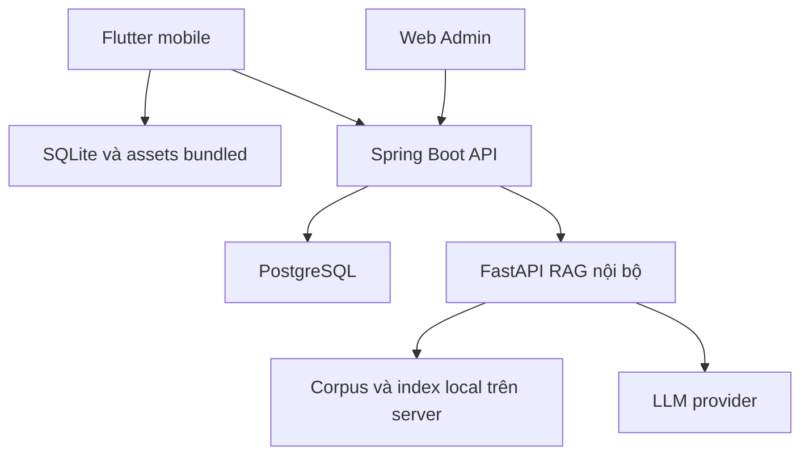

# FirstAid System Specification

Baseline 2.0 | 23/10/2026 | Đọc cùng [06_SHARED_CONTRACTS.md](06_SHARED_CONTRACTS.md).

## 1. Mục tiêu và giới hạn

FirstAid hỗ trợ người dân nhận biết tình huống sơ cứu, tiếp cận hướng dẫn ban đầu, tránh hành động sai và liên hệ hỗ trợ. Sản phẩm gồm Flutter mobile, web Admin, Spring Boot API và FastAPI RAG.

Mục tiêu đồ án là tạo một ứng dụng có nội dung tương đối đầy đủ, sử dụng thuận tiện, đọc được ngoại tuyến và có chatbot truy xuất tài liệu. Không đặt mục tiêu điều phối cấp cứu, chẩn đoán, kê đơn hoặc chứng minh tăng tỷ lệ sống sót.

Hai loại tương tác được tách rõ: **hướng dẫn khẩn cấp dùng nội dung cố định đã kiểm tra**; **chatbot hỗ trợ tra cứu kiến thức và giải thích có nguồn**. AI không tự sáng tác thủ thuật trong một sự cố đang xảy ra.

## 2. Phạm vi đã thống nhất

### 2.1 Bắt buộc P0

1. Người dùng sử dụng mobile không đăng ký/đăng nhập.
2. Khoảng 18 nhóm tình huống, có bài con/biến thể khi cách xử trí khác nhau.
3. Danh sách, phân nhóm, tìm kiếm và trang bài sơ cứu theo bước.
4. Chế độ Sơ cứu nhanh ưu tiên hành động; một số luồng hỏi đáp ngắn có lựa chọn cố định.
5. Các bài cốt lõi, nguồn metadata và hình minh họa đi kèm đọc được ngoại tuyến từ lần mở đầu sau cài.
6. Chatbot RAG bằng văn bản khi online, có citation và các trạng thái không trả lời được.
7. Danh bạ một khu vực thí điểm, xem gần vị trí, mở dialer và app bản đồ.
8. Admin đăng nhập, quản lý danh mục, bài, nguồn và cơ sở y tế.
9. Cập nhật nội dung thủ công khi có mạng bằng tải dữ liệu đầy đủ đơn giản.

### 2.2 Bổ sung P1 sau khi P0 ổn định

- Công cụ phát nhịp CPR đơn giản với cấu hình được kiểm tra.
- Hybrid retrieval nếu baseline RAG chưa đủ tốt và có thời gian đo.
- Cải thiện tìm kiếm từ đồng nghĩa, accessibility và hình minh họa.

### 2.3 Không triển khai

Tài khoản mobile, hồ sơ bệnh án, nhật ký nạn nhân, bookmark đồng bộ, quiz, diễn đàn, thông báo đẩy, nhập giọng nói, chẩn đoán bằng ảnh, huấn luyện PhoBERT/NER, điều phối xe, giường bệnh thời gian thực, quy trình duyệt nhiều vai trò, ký bundle, thu hồi/rollback nhiều phiên bản, microservice phức tạp.

Không biến các mục P1 thành điều kiện ngầm để hoàn thành P0.

Phạm vi đối tượng gồm **người lớn và trẻ em, không bao gồm nhũ nhi**. Bài trẻ em phải nêu rõ phạm vi áp dụng theo nguồn; không tự dùng cho nhũ nhi.

## 3. Tác nhân

| Tác nhân | Khả năng |
| --- | --- |
| Người dùng mobile | Đọc hướng dẫn, tìm kiếm, chat, xem nguồn, tìm và liên hệ cơ sở, cập nhật dữ liệu |
| Admin | Đăng nhập web và quản lý nội dung công khai, không truy cập lịch sử bệnh nhân vì hệ thống không có dữ liệu đó |
| Hệ điều hành | Cấp quyền vị trí, mở điện thoại/bản đồ, thông báo lifecycle và audio |
| Dịch vụ LLM | Sinh câu trả lời từ context đã lọc, không có quyền sửa dữ liệu hoặc gọi tool |

Chỉ một role kỹ thuật `ADMIN`. Người dùng công khai không phải một loại tài khoản trong database. Kiểm tra nội dung vẫn cần thực hiện trong nhóm/ngoài phần mềm; không cần xây role reviewer.

## 4. Danh mục nội dung

18 nhóm: người không đáp ứng; CPR/AED; hóc dị vật; đuối nước; chảy máu ngoài; vết thương nhỏ; chảy máu cam; nghi gãy xương; bong gân/trật khớp; chấn thương đầu/cổ/cột sống; bỏng; điện giật; say nóng/sốc nhiệt; nghi đột quỵ; co giật; dị ứng nặng/phản vệ; nghi ngộ độc; động vật cắn/côn trùng đốt.

Mã ổn định và cách chia bài có trong 07. Không gộp một hướng dẫn cho mọi nguyên nhân bỏng, loài động vật, loại ngộ độc hoặc lứa tuổi nếu cách xử trí khác nhau. Nội dung đủ rộng không đồng nghĩa xây 18 module code: cùng một schema và màn hình phục vụ toàn bộ danh mục.

## 5. Đặc tả yêu cầu

| Mã | Chức năng | Chấp nhận khi |
| --- | --- | --- |
| FR01 | Trang chủ và vào nhanh | Từ trang chủ mở Sơ cứu nhanh bằng một chạm; không login/onboarding chặn |
| FR02 | Danh mục và tìm kiếm | Xem đủ nhóm đã công bố; tìm có/không dấu và tên thường gặp trên tập từ khóa đã chuẩn bị |
| FR03 | Xem bài theo bước | Có nhận biết, cần làm, các bước, điều tránh, liên hệ hỗ trợ, đối tượng và nguồn |
| FR04 | Hai chế độ xem chung dữ liệu | `quick` ưu tiên bước; `learn` hiện đầy đủ; không tạo hai bản nội dung khác nhau |
| FR05 | Luồng hỏi đáp cố định | Các luồng giới hạn có lựa chọn rõ, có không chắc; không tự chọn hướng dẫn người lớn khi thiếu đối tượng |
| FR06 | Liên hệ hỗ trợ | Nút gọi hiện ở phần khẩn cấp; mở dialer do người dùng bấm; không kết luận đã kết nối |
| FR07 | Ngoại tuyến | Cài mới, airplane mode vẫn đọc được các bài cốt lõi và hình bundled |
| FR08 | Cập nhật nội dung | Thao tác thủ công tải full data; lỗi thì dữ liệu hiện tại vẫn đọc được; không đổi bài giữa lúc đang xem |
| FR09 | Chatbot RAG | Nhập text và nhận phản hồi theo schema, có nguồn cho khẳng định y khoa |
| FR10 | Giới hạn chatbot | Thiếu nguồn, thiếu dữ kiện, ngoài phạm vi, nguy cơ hoặc timeout có UI và hành vi riêng |
| FR11 | Xem nguồn | Citation mở đúng tên nguồn/trang; metadata nguồn đọc được offline nếu đã trong dữ liệu local |
| FR12 | Danh bạ khu vực | Có danh sách và chi tiết; không cấp vị trí vẫn chọn khu vực hoặc xem danh sách |
| FR13 | Cơ sở gần vị trí | Tính khoảng cách đường thẳng và sắp tăng dần; không gọi là thời gian di chuyển |
| FR14 | Gọi và mở bản đồ | Từ chi tiết cơ sở mở dialer hoặc app bản đồ, có phương án khi không mở được |
| FR15 | Admin đăng nhập | Một role, endpoint ghi có xác thực; public không đọc được bản nháp |
| FR16 | Admin CRUD nội dung | Danh mục, bài, bước, nguồn; có DRAFT/PUBLISHED đơn giản, validation trước publish |
| FR17 | Admin CRUD cơ sở | Quản lý tên, địa chỉ, vị trí, điện thoại, ngày/nguồn kiểm tra |
| FR18 | Quyền và lỗi | Từ chối vị trí không chặn app; trạng thái loading/empty/offline/error rõ |
| FR19 | Công cụ CPR P1 | Play/stop, asset local, xử lý audio interruption; chỉ làm khi P0 đạt |

## 6. Các luồng chính

### UC01 — Xem hướng dẫn nhanh

Tiền điều kiện: đã cài ứng dụng và có seed core. Người dùng chọn Sơ cứu nhanh → danh mục/tìm tình huống → chọn bài/đối tượng nếu có → đọc từng bước. Nút gọi luôn có. Nếu có luồng hỏi đáp cố định, câu trả lời chỉ điều hướng đến nội dung đã chuẩn bị. Chọn không chắc dẫn tới nhánh đã kiểm tra, không suy thành “không nguy hiểm”. Không cần Internet.

Nếu tình huống/đối tượng chưa có hướng dẫn phù hợp, hiển thị rõ giới hạn và lối liên hệ hỗ trợ; không thay bằng bài của nhóm đối tượng khác. Bấm Back quay lại danh sách; không có session hay nhật ký nạn nhân phải đồng bộ.

### UC02 — Đọc kiến thức

Trang Kiến thức → chọn nhóm hoặc tìm kiếm → đọc bài `learn` → mở nguồn nếu muốn. Phần nhận biết và giải thích chi tiết được mở mặc định hoặc qua section rõ ràng. Phần cần làm và điều tránh dùng cùng dữ liệu với chế độ nhanh.

### UC03 — Hỏi chatbot

Nhập câu hỏi → bấm gửi → server kiểm phạm vi/nguy cơ → retrieval từ corpus đã chuẩn bị → sinh và kiểm response → hiển thị câu trả lời cùng nguồn. Mô tả sự cố rõ ràng cần ưu tiên lối gọi và mở hướng dẫn cố định. Không chờ một câu trả lời dài để người dùng biết có lối khẩn cấp.

Nếu offline: không gửi request, hiện thông báo và nút tìm trong kiến thức local. Nếu provider lỗi: giữ câu hỏi tại màn hình, cho thử lại chủ động; không tự gửi lặp nhiều lần. Chat history chỉ giữ trong phiên tại thiết bị; server không lưu nội dung chat mặc định.

### UC04 — Tìm cơ sở y tế

Mở danh bạ → xem danh sách khu vực hoặc bấm Dùng vị trí → cấp quyền nếu muốn → sắp theo khoảng cách đường thẳng → mở chi tiết → gọi hoặc mở bản đồ ngoài. Không có quyền/vị trí thì vẫn xem danh sách. Dữ liệu offline chỉ gồm vùng đã có trên máy, kèm ngày kiểm tra thông tin.

### UC05 — Quản lý bài

Admin đăng nhập → danh sách bài → tạo/sửa bài DRAFT → điền nội dung, đối tượng, nguồn/trang và hình → preview → publish bằng chính tài khoản Admin. Không có yêu cầu người khác duyệt trong phần mềm. Không publish bài thiếu trường bắt buộc/nguồn hợp lệ. Việc kiểm tính đúng y khoa thực hiện trước thao tác này, không được coi validation form là thẩm định.

### UC06 — Cập nhật dữ liệu mobile

Người dùng mở Cài đặt → Cập nhật nội dung → tải full snapshot từ API → kiểm schema và liên kết → ghi SQLite trong một transaction → thông báo hoàn tất. Nếu đang mở bài, hoãn cập nhật cho đến khi rời bài. Lỗi mạng/validation không xóa dữ liệu cũ. Chỉ lưu bộ dữ liệu hiện hành, không xây lịch sử bundle và rollback.

### UC07 — Quản lý tài liệu và corpus

Admin quản lý metadata nguồn và gắn nguồn vào bài. Nhóm AI xử lý các tài liệu đã chọn bằng script, kiểm nội dung, xây corpus và index. Không có tính năng ingest PDF bất kỳ tự động trên web Admin. Khi corpus RAG khác phiên bản bài mới, nguồn trong chat phải thể hiện snapshot rõ; nguồn bị gỡ phải bị gateway chặn.

## 7. Quy tắc nghiệp vụ tối thiểu

- BR01: Người dùng mobile không bị buộc đăng nhập hoặc cấp quyền để đọc hướng dẫn.
- BR02: Nội dung hướng dẫn không do LLM tự sinh khi người dùng mở bài.
- BR03: Bài và corpus phải có đối tượng áp dụng và evidence phù hợp; không suy đoán tuổi từ mặc định UI.
- BR04: Chỉ bài PUBLISHED được trả qua API public và đưa vào snapshot offline.
- BR05: Bài đã được tải có thể cũ khi offline; hiển thị ngày cập nhật, không cam kết nhận sửa đổi tức thì.
- BR06: Nguồn có citation không có nghĩa đã chứng minh đúng; nhóm phải kiểm câu trả lời được nguồn hỗ trợ.
- BR07: Bảng câu hỏi đúng/sai trong tài liệu không được ingest nguyên như hướng dẫn.
- BR08: Không chẩn đoán, kê liều thuốc hoặc cam kết cơ sở y tế tiếp nhận được.
- BR09: Không thu thập định danh, hình nạn nhân hay vị trí nền.
- BR10: Mở dialer/map là thao tác do người dùng chủ động, không tự gọi/gửi vị trí.
- BR11: Không ghi đè bài đang hiển thị bằng kết quả sync giữa chừng.
- BR12: Xóa/gỡ bài hoặc nguồn phải kiểm liên kết; citation và guided route không được mở dữ liệu không hợp lệ. Guided route thiếu bài sau cập nhật hiện unsupported.

## 8. Kiến trúc triển khai vừa sức

Spring là ứng dụng chính, không tách nhiều microservice. Python chỉ phụ trách AI. Corpus/index là tệp có version do nhóm chuẩn bị, không cần một vector database riêng. PostgreSQL không bắt buộc PostGIS; với danh bạ nhỏ, tính Haversine trong ứng dụng/service là đủ. Chưa cần Redis, Kafka hoặc Kubernetes.

Admin mặc định React + TypeScript nếu repo chưa có lựa chọn khác. Mobile có thể tổ chức feature-based với một state manager thống nhất theo repo. Không pin tên phiên bản framework khi chưa kiểm repo/build; sau khi chốt phải ghi vào lockfile và README thực tế.

## 9. Cấu trúc dữ liệu nghiệp vụ

Các đối tượng chính: Category, Article, Step, Source, SourceReference, Facility, AdminUser. Article giữ `variant_key` và `age_group`; nhóm tình huống là Category. Mỗi bài tương ứng một biến thể độc lập, không để cùng một mảng steps chứa chỉ dẫn trộn nhiều đối tượng. Guided flow JSON giới hạn do developer quản lý trong app, không tạo CMS graph editor.

ChatRequest/ChatResponse là DTO, không tạo bảng Conversation/Patient. OfflineSnapshot là DTO chứa danh mục, bài, nguồn, cơ sở và version. Schema chi tiết, mã lỗi và endpoint ở 06; không tự đổi tên trường giữa các phần.

## 10. Chất lượng và tiêu chí sản phẩm

- Đọc hướng dẫn được khi cài mới và không mạng.
- Có nội dung sử dụng được cho đủ 18 nhóm sau chuẩn bị dữ liệu; bài con phụ thuộc nhu cầu nội dung và nguồn.
- Không công bố bài chưa có nguồn; phần thiếu dùng nhãn chưa có nội dung, không bịa để đủ số lượng.
- Từ trang chủ đến hướng dẫn không có login/modal quyền bắt buộc.
- Chat hiển thị nguồn kiểm chứng được và biết từ chối; lỗi AI không ảnh hưởng phần local.
- Trang quản trị đơn giản nhưng chặn API ghi trái phép.
- UI dùng được trên Android thật; iOS chỉ tuyên bố hỗ trợ sau kiểm thử.
- Tiêu chí đo, test và kế hoạch ở 08.

## 11. Những việc còn phải chốt khi triển khai

`[TODO / NEED DECISION]` Provider/model LLM, ngân sách sử dụng, khu vực/dữ liệu cơ sở thật, người kiểm nội dung và quyền tái sử dụng ảnh/tài liệu, hạ tầng deploy và thiết bị nghiệm thu. Có thể làm toàn bộ khung UI, CRUD, schema và mock contract trước khi có các quyết định này. Mock tuyệt đối không gắn nhãn nội dung y khoa đã được thẩm định.
