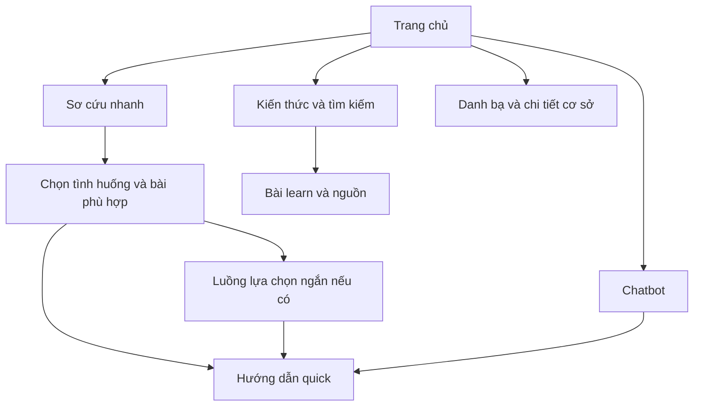

# Figma Design Brief

Baseline 2.0 | Đầu vào thiết kế, không phải yêu cầu chỉnh một file Figma cụ thể. Đọc [01_SYSTEM_SPEC.md](01_SYSTEM_SPEC.md), [06_SHARED_CONTRACTS.md](06_SHARED_CONTRACTS.md) và [07_CONTENT_CATALOG.md](07_CONTENT_CATALOG.md).

## 1. Mục tiêu thiết kế

Thiết kế mobile FirstAid dễ tìm, dễ đọc và ít thao tác trong tình huống căng thẳng; đồng thời có giao diện học kiến thức, hỏi chatbot và tìm cơ sở y tế. Thiết kế thêm web Admin vừa đủ cho CRUD, không làm dashboard bệnh viện hoặc workflow quản trị nhiều vai trò.

Người dùng không đăng nhập. Không thiết kế màn hình đăng ký, hồ sơ cá nhân, hồ sơ nạn nhân, bảng thành tích, quiz, camera, voice recording, thông báo đẩy hay điều xe. Không đưa các tính năng ngoài scope vào mockup chỉ để lấp chỗ trống.

## 2. Đầu ra Figma cần có

- Page `00 Cover and flows`: phạm vi và sơ đồ điều hướng.
- Page `01 Foundations`: màu, chữ, spacing, icon và trạng thái.
- Page `02 Components`: component và variants thực sự được dùng.
- Page `03 Mobile`: màn hình happy path và các trạng thái quan trọng.
- Page `04 Admin`: quản lý nội dung, nguồn và cơ sở y tế.
- Page `05 Handoff`: mapping screen → FR → API/data, ghi chú responsive và prototype.

Dùng Auto Layout, constraints và component variants; không dựng mỗi màn hình bằng một ảnh phẳng. Nội dung và nút phải chỉnh sửa được. Brief này không yêu cầu tạo design system lớn hay variable modes phức tạp.

## 3. Phong cách và nền tảng

Phong cách rõ ràng, tin cậy, nhẹ, ưu tiên chữ và hình hướng dẫn. Nền sáng, đỏ dùng cho hành động khẩn cấp, xanh đậm cho hành động thường. Tránh ảnh nạn nhân gây sợ, banner marketing, gradient rực hoặc nhiều animation. Logo đơn giản có thể chỉ dùng chữ FirstAid và một biểu tượng trung tính.

Frame mobile chính 390 × 844; kiểm thêm 360 × 800 và màn hình lớn 430 × 932. Đây là vùng thiết kế logic, không đặt pixel cố định khi triển khai Flutter. Giữ safe area cho system bars. Khả năng tăng cỡ chữ và cuộn quan trọng hơn giữ mọi nội dung trong một màn hình.

Admin desktop 1440 × 900; kiểm tại 1280 px. Web Admin không bắt buộc thao tác hoàn chỉnh trên điện thoại trong P0, nhưng không vỡ layout ở tablet.

## 4. Foundations đề xuất

| Token | Giá trị gợi ý | Mục đích |
| --- | --- | --- |
| color/background | #F8FAFC | Nền chung |
| color/surface | #FFFFFF | Card, sheet, form |
| color/text/primary | #0F172A | Chữ chính |
| color/text/secondary | #475569 | Nội dung phụ |
| color/primary | #0F766E | Điều hướng và hành động thường |
| color/emergency | #B91C1C | Nút gọi/lối sơ cứu nhanh |
| color/border | #CBD5E1 | Border, divider |
| color/info-bg | #EFF6FF | Trạng thái thông tin |
| color/warning-bg | #FFFBEB | Lưu ý, dữ liệu cũ |

Đây là bảng màu đầu vào. Designer phải kiểm contrast của cặp foreground/background sử dụng thật; không mặc định mọi tổ hợp màu trong bảng đều đạt chuẩn. Warning luôn có icon/nhãn, không dùng riêng màu để truyền nghĩa.

Font hỗ trợ tiếng Việt tốt, đề xuất Be Vietnam Pro hoặc font hệ thống phù hợp. Mobile: tiêu đề 24–28, section 20, body 16–18; quick steps ưu tiên 18–20; label 14–16. Tránh body dài 12 px. Line height 1.4–1.5. Spacing scale 4, 8, 12, 16, 24, 32. Vùng chạm tối thiểu đề xuất 48 × 48 logical pixels, có khoảng cách giữa các lựa chọn.

Bo góc card 12–16, button 10–12. Không biến mọi thông tin thành card lồng nhau; phần bước hướng dẫn nên có nhịp đọc rõ. Các đoạn y khoa dài dùng list/section, không ép thành dòng rất nhỏ.

## 5. Kiến trúc điều hướng mobile

Bottom navigation: **Trang chủ — Kiến thức — Hỏi đáp — Cơ sở y tế**. Cài đặt nằm ở góc trang chủ. Sơ cứu nhanh là CTA nổi bật từ Trang chủ, mở flow riêng; không dùng bottom tab thứ năm chỉ vì cần thêm tính năng.



Nút gọi hỗ trợ phải có ở quick flow và thẻ emergency_redirect trong chat. Không đặt nút gọi toàn màn hình che nội dung trong mọi tab. Bấm gọi mở dialer; prototype ghi chú đây là handoff, không vẽ trạng thái “xe đang đến”.

## 6. Danh sách màn hình mobile

| ID | Màn hình | Nội dung chính | Trạng thái cần có |
| --- | --- | --- | --- |
| M01 | Trang chủ | CTA Sơ cứu nhanh, gọi hỗ trợ, nhóm nổi bật, tìm kiến thức, cài đặt | Bình thường, offline có nội dung |
| M02 | Danh sách sơ cứu nhanh | 18 nhóm, tìm theo từ khóa, nhóm phân loại | Có kết quả, không có kết quả |
| M03 | Chọn bài hoặc đối tượng | Các biến thể theo danh mục; badge người lớn/trẻ/nhũ nhi/dùng chung | Có nhiều bài, không hỗ trợ đối tượng |
| M04 | Hướng dẫn quick | Phạm vi, cần làm ngay, bước, điều tránh, gọi và xem nguồn | Đầu/giữa/cuối bài, thiếu hình online, chữ lớn |
| M05 | Luồng lựa chọn ngắn | Một câu hỏi, đáp án đóng, không chắc, nút gọi | Câu hỏi, kết quả mở bài, không có bài phù hợp |
| M06 | Kiến thức và tìm kiếm | Search, nhóm chủ đề, danh sách bài | Loading lần đầu seed, kết quả, rỗng |
| M07 | Bài learn | Nhận biết, giải thích, bước, điều tránh, khi cần hỗ trợ và nguồn | Online/offline, nội dung dài |
| M08 | Chi tiết nguồn | Tên, đơn vị, năm, trang trích, note | Có URL hoặc chỉ metadata |
| M09 | Chatbot | Câu hỏi text, phản hồi, nguồn, giới hạn xử lý độc lập từng câu | Sáu ChatStatus và offline |
| M10 | Danh bạ | Vùng, dùng vị trí, danh sách, khoảng cách khi có | Có/không vị trí, offline, danh sách rỗng |
| M11 | Chi tiết cơ sở | Tên, địa chỉ, số, thông tin 24/7, ngày kiểm tra, gọi/map | UNKNOWN 24/7, không mở được app ngoài |
| M12 | Cài đặt và dữ liệu | Phiên bản dữ liệu, ngày tải, cập nhật nội dung, giới thiệu | Updating, unchanged, success, failed |
| M13 | Công cụ CPR P1 | Nhịp, play/stop, trạng thái audio | Chỉ thiết kế sau P0; ghi OPTIONAL |

M03 có thể bỏ qua nếu danh mục chỉ có một bài dùng đúng đối tượng rõ ràng; không bỏ qua bằng mặc định ADULT khi chưa biết người dùng chọn gì. M04 và M07 là hai mode của cùng Article; dùng chung component sections, không tạo hai bộ dữ liệu.

## 7. Bố cục màn hình trọng tâm

### M01 Trang chủ

Header ngắn “FirstAid”, nút cài đặt. Bên dưới là CTA “Cần sơ cứu ngay” nổi bật; nút phụ “Gọi hỗ trợ” với số theo app_config. Tiếp theo là ô tìm kiến thức và các lối nhóm, không cần một dashboard chỉ số. Hiển thị “Hướng dẫn có sẵn trên thiết bị” hoặc phiên bản ở vị trí phụ, không tạo banner offline che CTA.

### M04 Hướng dẫn quick

Header Back, tên tình huống ngắn, nhãn đối tượng. Phạm vi áp dụng được thấy trước khi đọc thao tác. Section “Cần làm ngay” ngắn; component StepCard hiển thị tiêu đề, instruction, hình và alt text hỗ trợ. Có thể cuộn toàn bài hoặc dùng điều hướng bước, nhưng nút “Bước tiếp” chỉ nghĩa xem bước tiếp theo, không ghi nhận người dùng đã thực hiện.

Nút gọi ở bottom action area có safe-area, không che dòng cuối. Các mục “Không nên làm”, “Khi cần hỗ trợ” và “Nguồn” vẫn tiếp cận dễ. Không hiển thị thanh “80% đã cứu xong”, chấm điểm CPR hoặc đồng hồ đếm thời gian sống còn.

### M05 Lựa chọn ngắn

Một câu hỏi tại một thời điểm; lựa chọn lớn và diễn giải ngắn nếu nguồn yêu cầu. Luôn có lựa chọn không chắc ở câu cần thiết và nút gọi. Không giả lập toàn bộ phác đồ chuyên môn bằng cây nhiều nhánh. Dùng text mẫu trung tính trong mock nếu câu hỏi chuyên môn chưa được cung cấp, ví dụ “Câu hỏi đã chuẩn bị theo nguồn”, không tự viết hướng dẫn y khoa.

### M09 Chatbot

Header nêu “Tra cứu kiến thức từ tài liệu”. Gợi ý không nhập thông tin cá nhân. Tin nhắn user và answer dễ phân biệt; câu trả lời có citation chips mở M08. Ô nhập nhiều dòng giới hạn hợp lý, nút gửi disabled khi rỗng/đang gửi. P0 không voice icon, attachment icon hoặc camera icon.

Không stream chữ. Khi chờ: hiển thị “Đang tra cứu tài liệu…”. emergency_redirect là thẻ cố định có CTA “Gọi hỗ trợ” và “Mở hướng dẫn”, không dùng bubble chẩn đoán. unavailable giữ câu hỏi và cho retry. clarification_needed không giả vờ ghi nhớ một hồ sơ; hướng dẫn người dùng gửi câu đầy đủ có thông tin bổ sung theo contract stateless.

### M10 Danh bạ

Danh sách là giao diện chính, không cần bản đồ embedded. Nút “Dùng vị trí hiện tại” chỉ xin quyền sau bấm. Mỗi cơ sở có tên, địa chỉ ngắn, khoảng cách “đường thẳng” nếu có và thời điểm kiểm tra. Không nhãn “bệnh viện tốt nhất” hoặc chắc chắn nhận bệnh. Từ chối vị trí vẫn xem dữ liệu theo vùng.

## 8. Thiết kế web Admin

Sidebar gọn: **Bài sơ cứu — Danh mục — Nguồn tài liệu — Cơ sở y tế**. Header có tên Admin và đăng xuất. Sau login vào danh sách bài, không cần dashboard biểu đồ.

| ID | Màn hình | Thành phần và tương tác |
| --- | --- | --- |
| A01 | Đăng nhập | Username/password, lỗi sai tài khoản, loading |
| A02 | Danh sách bài | Search, lọc danh mục/trạng thái, tạo, sửa, publish/unpublish, xác nhận xóa |
| A03 | Form bài và preview | Nội dung theo section, bước thêm/xóa/sắp thứ tự, đối tượng, nguồn/trang, checkbox kiểm nội dung |
| A04 | Danh mục | Bảng 18 nhóm, form thêm/sửa; cảnh báo đang có bài khi xóa |
| A05 | Nguồn tài liệu | Metadata, năm/trang, trạng thái; không nút huấn luyện AI hay upload PDF tự động |
| A06 | Danh sách cơ sở | Search/vùng, thêm/sửa/xóa/deactivate |
| A07 | Form cơ sở | Tên, địa chỉ, số, tọa độ, UNKNOWN 24/7, note và ngày xác minh |

A03 chia section rõ, không cần rich text editor đầy đủ. Preview mobile dùng cùng trường dữ liệu như app. Khi lưu sửa bài public sẽ chuyển DRAFT, cần confirmation mô tả tác động; sau đó nút Publish khi đủ thông tin. Không thêm nút “Gửi người duyệt” hoặc trạng thái approved/in_review.

## 9. Component tối thiểu

Button(primary/secondary/emergency/destructive, default/loading/disabled); SearchField; CategoryItem; ArticleCard; AgeGroupBadge; SectionHeading; StepCard; WarningList; SourceChip; SourceSheet; FacilityCard; StatusView(loading/empty/offline/error); ChatAnswer; EmergencyRedirectCard; ConfirmDialog; AdminDataTable; FormField; StepEditor; ReferenceEditor.

Component chỉ thể hiện hành vi đã có trong scope. Nút destructive dùng nhãn cụ thể như “Xóa cơ sở”, không chỉ “OK”. Error text nói cách tiếp tục, không hiển thị trace_id như thông tin chính; trace_id có thể trong phần hỗ trợ nếu cần.

## 10. Các prototype phải nối được

1. M01 → M02 → M03 nếu cần → M04 → M08 → quay lại.
2. M01 → M02 → M05 → M04 hoặc trạng thái chưa hỗ trợ.
3. M06 → tìm kiếm → M07 → M08.
4. M09 → answered → citation; emergency_redirect → M04; offline → M06.
5. M10 → cấp/từ chối vị trí → M11 → handoff dialer/map.
6. M12 → cập nhật thành công/thất bại, vẫn mở hướng dẫn.
7. A01 → A02 → A03 → lưu DRAFT → preview → publish.
8. A05/A07 → lỗi validation → sửa → lưu.

Không cần nối mọi nút trong mọi variant, nhưng prototype chính không có ngõ cụt. Annotate hành vi native không thể mô phỏng như cuộc gọi và permission.

## 11. Checklist handoff

- Mỗi frame ghi screen ID, mode và trạng thái.
- Bảng map component vào field trong 06; không tự thêm field hồ sơ, avatar, rating.
- Mẫu title/source/facility chưa xác minh gắn rõ placeholder/demo.
- Hình hướng dẫn không tự sinh tư thế/thao tác; dùng asset được nhóm chuẩn bị hoặc khung chờ có mô tả.
- Có màn hình chữ lớn 200%, trường hợp title dài và bài nhiều bước.
- Nội dung cuộn được, nút gọi không bị bàn phím/bottom bar che.
- Tương phản, focus, keyboard admin và screen reader labels được ghi chú.
- File Figma phải thể hiện ưu tiên P0/P1, không để người triển khai hiểu M13 là bắt buộc.

## 12. Prompt giao cho người hoặc công cụ thiết kế

```text
Thiết kế FirstAid theo 01_SYSTEM_SPEC.md và brief này.
Làm mobile P0 trước, sau đó web Admin một role.
Giữ 18 nhóm tình huống nhưng dùng chung mẫu bài; không thêm login mobile,
voice, camera, nhật ký nạn nhân, quiz hoặc workflow duyệt nhiều cấp.
Tạo Auto Layout, component variants và các trạng thái offline/error.
Không tự viết hướng dẫn y khoa hoặc dữ liệu bệnh viện thật.
Nối prototype các luồng trong mục 10 và handoff theo field của 06_SHARED_CONTRACTS.md.
```
